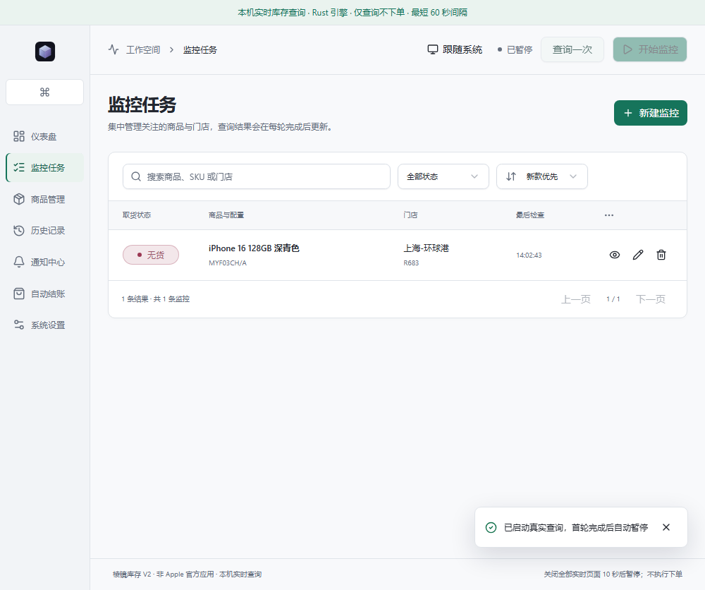

# 棱镜库存 · Prism Stock

一个用于关注 Apple 零售店取货库存的桌面工作台。按商品配置和门店创建监控，清晰查看查询结果、库存变化及运行异常。



## 新手第一次使用

**还没有打开软件？** 当前提供的是源码，不是下载 ZIP 后双击就能用的成品。首次启动需要先完成[部署步骤](docs/DEVELOPMENT.md)，也可以请熟悉电脑的朋友协助；部署完成后，日常只需按下面的步骤操作。

页面打开后，按下面操作即可：

1. 点击左侧「商品管理」，选择你要购买的地区和商品品类。
2. 点击产品系列，筛选容量、颜色，再打开「选择具体配置」并勾选一款商品。只选筛选条件还不算选中了商品。
3. 选择城市 / 区域，再打开「选择零售店」勾选一家门店。
4. 确认底部显示「1 个 SKU × 1 家门店」，点击「添加 1 项」。SKU 就是一款具体容量、颜色的商品配置。
5. 点击左侧「监控任务」，先点顶部「查询一次」，等待「最后检查」更新。查询完自动变为「已暂停」是正常的。

想持续关注库存，再点「开始监控」；不想继续时点「暂停监控」。如果提示需要等待，按提示等候，不要连续点击查询。

「有货」表示本次查到可取货；「无货」表示本次不可取货；「未知 / 查询失败」不等于无货。购买前仍需自己到 Apple 官方页面确认。当前浏览器版不支持手机推送和真实下单。

[查看完整新手教程：首次查询、持续监控、常见问题](docs/GETTING_STARTED.md)

## 功能

- 中文工作台：仪表盘、监控任务、商品管理、历史记录、通知中心、自动结账（桌面版实验功能，默认关闭）与系统设置。
- 分层选品：按产品系列、容量和颜色筛选，按城市选择门店，支持多选与重复任务检查。
- 库存查询：单次查询、定时监控、暂停，以及有货、无货和未知状态展示。
- 任务管理：编辑、删除、搜索、筛选、排序和完整详情。
- 深色与浅色主题，适配不同窗口大小。
- 查询耗时、有效结果率和当前会话历史；历史暂不跨重启保留。

## 开发者部署

普通使用者请先阅读上面的新手步骤。以下命令只用于首次部署或开发，完整环境准备和停止方法见[部署指南](docs/DEVELOPMENT.md)。

准备 Node.js 24、pnpm 9、Rust stable 和 Chrome 或 Edge。Windows 还需要 MSVC Build Tools（C++ 桌面开发及 Windows SDK）和 WebView2。

```powershell
git clone https://github.com/ffeus/prism-stock.git
cd prism-stock
pnpm install --frozen-lockfile
pnpm inventory:build
pnpm inventory:dev
```

使用终端显示的本地地址打开页面，选择商品配置和门店，添加任务后点击“查询一次”或“开始监控”。服务默认暂停；停止服务使用 Ctrl+C。

本地查询服务只供本机使用，不应暴露到公网。最短查询间隔为 60 秒，最多 20 个 SKU × 门店组合；被拦截或限流时保留未知状态并暂停，不会误报无货。库存结果仅代表查询时刻，最终以官方购买页面为准。

## 运行模式

| 命令 | 用途 |
|---|---|
| `pnpm inventory:dev` | 本机真实取货库存查询；不登录、不下单、不付款，暂未接入手机推送 |
| `pnpm preview:mock` | 离线界面体验，库存和操作均为模拟数据 |
| `pnpm tauri dev` | Windows 桌面开发运行，包含原生设置及辅助功能入口 |
| `pnpm tauri build --no-sign` | 生成未签名桌面安装包，不执行安装 |

自动结账属于桌面版辅助功能，默认关闭。当前仅完成本地模拟验收，未验证真实订单提交；浏览器查询入口不开放结账。Bark 真实手机送达也尚未验收，不能将模拟成功当作实际送达。

## 测试

```powershell
pnpm test
pnpm exec tsc --noEmit
pnpm build
pnpm exec playwright install chromium
pnpm test:e2e
cargo fmt --all -- --check
cargo clippy --workspace --all-targets --all-features -- -D warnings
cargo test --workspace
```

上述默认测试不会提交订单。真实接口测试需要单独授权，不要直接开启全部 ignored/live 测试。

[测试记录与已知限制](docs/PUBLISHING.md) · [问题反馈](https://github.com/ffeus/prism-stock/issues)

## 数据与安全

设置和浏览器资料使用独立目录，不自动导入其他应用的账号、密钥或联系人。应用内更新暂时关闭。当前提供源码运行；未签名构建包尚未完成正式安装、卸载及升级验收。

本项目不是 Apple 官方软件，不能保证查询始终可用，也不能预留库存或保证购买成功。

## 许可证

采用 GPL-3.0-or-later，完整条款见 [LICENSE](LICENSE)。版权、来源和修改声明见 [NOTICE](NOTICE)。
